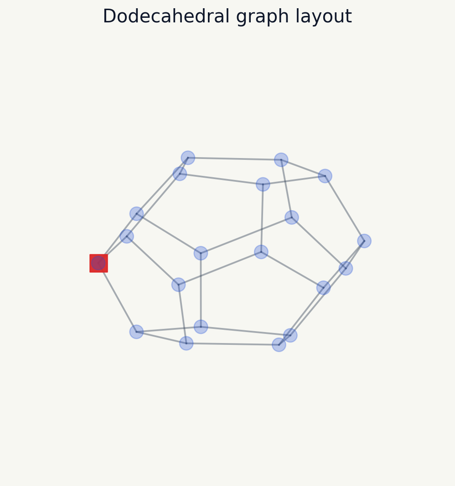

# SkyCanvas

SkyCanvas is a Python prototype for exploring 3D graph layouts and simple random-walk visualizations. It uses NetworkX to build graph structures and Matplotlib to render node positions, edges, labels, and a highlighted walk state.

The project was inspired by the idea of mapping points in 3D space for aerial displays. This repository is not a drone control system. It does not include image segmentation, flight planning, collision avoidance, LED control, or hardware integration.



## What it does

- Builds 3D layouts for cycle and dodecahedral graphs.
- Renders graph nodes and edges as a 3D Matplotlib scene.
- Produces a deterministic random walk through the graph.
- Saves a PNG preview that can be regenerated from the command line.

## Tech stack

- Python
- NetworkX
- NumPy
- Matplotlib
- Pytest

## Setup

```bash
python -m venv .venv
source .venv/bin/activate
python -m pip install --upgrade pip
python -m pip install -e ".[dev]"
```

## Usage

Render the default dodecahedral graph:

```bash
skycanvas --output assets/demo.png
```

Render a cycle graph with a custom node count:

```bash
skycanvas --graph cycle --nodes 32 --output assets/cycle-demo.png
```

Run tests:

```bash
MPLBACKEND=Agg python -m pytest -q
```

## Project structure

```text
src/skycanvas/
  cli.py       Command-line entry point
  graph.py     Graph construction, random walk, and rendering logic
tests/
  test_graph.py
assets/
  demo.png     Generated example render
```

## Current limits

SkyCanvas is a visualization prototype. The next technical step would be mapping image pixels to 3D coordinates, then adding constraint checks for spacing, camera perspective, and animation timing.
